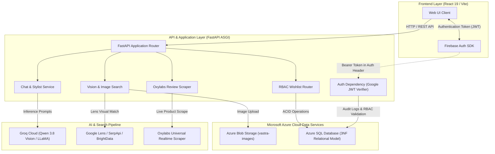
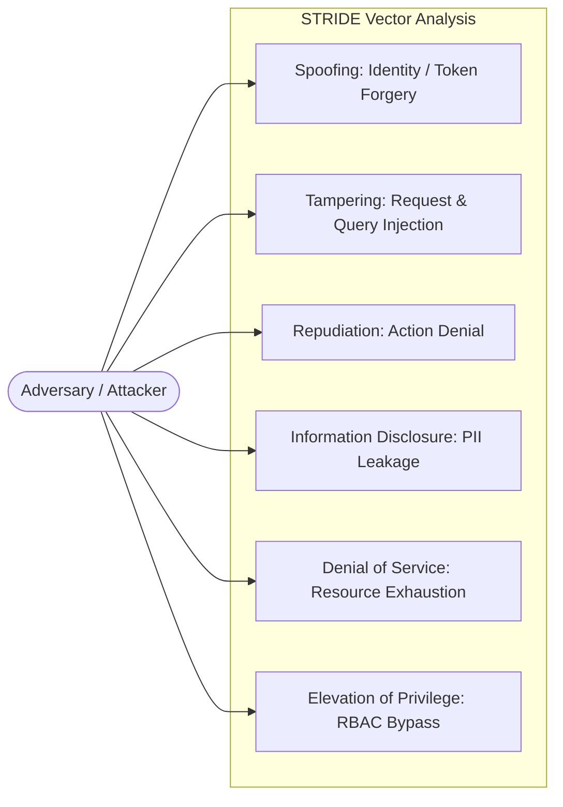

# VASTRA: Final Technical Architecture & Cloud Engineering Report

**Course Reference:** DP-900 / Cloud Data & Application Architecture  
**System:** VASTRA — AI-Driven Personal Fashion Stylist & E-Commerce Discovery Platform  
**Target Platform:** Azure Cloud (Azure SQL Database, Azure Blob Storage) & FastAPI Microservices

---

## 1. High-Level Architecture

### 1.1 Architectural Overview

VASTRA is engineered as a decoupled, asynchronous cloud-native application tailored for e-commerce intelligence and personalized fashion styling. The platform integrates modern frontend web capabilities with an asynchronous Python backend, high-throughput AI inference pipelines, resilient web scrapers, and enterprise-grade Microsoft Azure managed data stores.



### 1.2 Core Architectural Subsystems

1. **Presentation Layer (React 19 / Vite)**
   - Single-Page Application (SPA) leveraging React Router v7, Framer Motion for luxury animations, and TailwindCSS for responsive layouts.
   - Asynchronous data fetching paradigm: Long-running external tasks (e.g., live retailer review scraping via Oxylabs) are decoupled from instant AI styling recommendations (`POST /product-details`), preventing UI thread blockage.

2. **Backend Application Layer (FastAPI / Uvicorn)**
   - High-concurrency asynchronous runtime powered by Starlette and Pydantic v2.
   - Native Python thread pooling (`run_in_threadpool`) offloads synchronous SDK I/O (Azure Storage SDK, Groq SDK) without interrupting the event loop.
   - Automated startup lifecycle (`lifespan`) handles relational schema initialization and verification on Azure SQL.

3. **External Cognitive & Scraper Services**
   - **Groq Cloud API**: Low-latency LLM inference enforcing domain-specific Indian fashion vocabulary rules, outfit compatibility heuristics, and wardrobe synthesis.
   - **Oxylabs Realtime Scraper**: Parses genuine customer reviews, ratings, and author names from Flipkart and Amazon India, guarded by 30-second asynchronous timeouts.
   - **Google Lens & SerpApi**: Visual product identification mapping uploaded garments to retail availability.

4. **Persistence Layer**
   - **Azure Blob Storage**: Object store hosting binary image assets within the `vastra-images` container.
   - **Azure SQL Database**: Managed relational data store enforcing Third Normal Form (3NF) data integrity, relational constraints, and ACID transactions.

---

## 2. Data Classification: Azure SQL vs. Azure Blob Storage

DP-900 foundational principles establish clear demarcation between **structured relational data** and **unstructured object data**. VASTRA implements this separation strictly:

```
┌────────────────────────────────────────────────────────────────────────┐
│                        DATA CLASSIFICATION MATRIX                      │
├───────────────────────────────────┬────────────────────────────────────┤
│     AZURE SQL DATABASE (3NF)      │     AZURE BLOB STORAGE (OBJECT)    │
├───────────────────────────────────┼────────────────────────────────────┤
│ • Highly structured relational    │ • Unstructured binary media        │
│ • Strong ACID consistency         │ • High-scale, cost-effective BLOBs │
│ • Entity keys, FKs, constraints   │ • Key-value URI retrieval          │
│ • Audit trails & user identities  │ • Image payloads for visual search │
└───────────────────────────────────┴────────────────────────────────────┘
```

### 2.1 Detailed Storage Comparison

| Dimension | Azure SQL Database | Azure Blob Storage |
| :--- | :--- | :--- |
| **Data Nature** | Highly Structured (Relational Tables, Foreign Keys) | Unstructured (Binary Large Objects - JPEG, PNG, WEBP) |
| **Primary Entities** | `users`, `products`, `wishlist`, `reviews`, `activity_logs` | User-uploaded garment photos, wardrobe images |
| **Target Container** | Database: `vastra`, Schema: `dbo` | Storage Container: `vastra-images` |
| **Data Sensitivity** | **Confidential / PII** (Emails, User IDs, Wishlist preferences, IP logs) | **Internal / Restricted** (Temporary visual query images) |
| **Consistency Model** | Immediate Consistency (Full ACID) | Eventual Consistency / Read-After-Write |
| **Access Control** | SQL Authentication / Entra ID, Connection Strings, Row-Level Security | Storage Account Keys, Shared Access Signatures (SAS), Container Blob Anonymous Read |
| **Query Mechanism** | T-SQL, SQLAlchemy ORM, Stored Procedures, Views | REST API, Azure Storage Blob SDK (`upload_blob`, `get_blob_client`) |
| **Backup & Retention** | Point-in-Time Restore (PITR), Automated 7–35 day geo-redundant backups | Container Soft Delete, Blob Versioning, Hot/Cool/Archive Tiering |

### 2.2 Third Normal Form (3NF) Normalization Analysis

The relational schema defined in `backend/app/models/schema.py` and `database/schema.sql` satisfies all requirements of 3NF:

1. **First Normal Form (1NF)**:
   - All columns hold atomic scalar values (no comma-delimited strings or JSON arrays stored in place of relational entities).
   - Each table possesses an immutable single-column surrogate primary key (`id IDENTITY(1,1)`).
2. **Second Normal Form (2NF)**:
   - Satisfies 1NF.
   - All non-key attributes depend fully on the primary key. In junction tables such as `wishlist` and `reviews`, surrogate keys eliminate partial functional dependencies, while composite business keys (`user_id`, `product_id`) are enforced through `UNIQUE` constraints.
3. **Third Normal Form (3NF)**:
   - Satisfies 2NF.
   - Eliminates transitive dependencies: Attributes of a product (such as `brand`, `price`, `title`) reside strictly within `products` and are never duplicated within `wishlist` or `reviews`. User profile details (`email`, `display_name`) reside strictly within `users`. Derived metrics (such as average product rating) are calculated on-demand via the `vw_ProductAnalyticsSummary` database view rather than stored statically.

---

## 3. Threat Model (STRIDE Methodology)

The VASTRA platform threat model evaluates potential attack vectors across the six STRIDE domains:



### 3.1 STRIDE Threat Matrix & Countermeasure Mapping

| Threat Category | Potential Attack Scenario | Impact | Implemented Countermeasure |
| :--- | :--- | :--- | :--- |
| **Spoofing Identity** | Malicious actor attempts to forge Firebase JWT or impersonate another user ID in headers. | Unauthorized account takeover; identity spoofing. | **Server-side JWT Verification**: `backend/app/dependencies/auth.py` validates token signature with Google's public tokeninfo endpoint, checking `aud == FIREBASE_PROJECT_ID` and `iss == https://securetoken.google.com/{project_id}`. |
| **Tampering with Data** | Injection of malicious SQL fragments into search or review parameters; in-transit payload manipulation. | Database corruption, data breach. | **SQLAlchemy ORM Parameterization**: All SQL queries execute via parameterized drivers (`pyodbc`), neutralizing SQL injection. In-transit encryption enforced via TLS 1.2/1.3 (`Encrypt=yes`). |
| **Repudiation** | User denies performing an administrative action, saving an item, or uploading an inappropriate image. | Lack of auditability, inability to trace rogue events. | **Centralized Activity Audit Trail**: Every significant event (search, upload, review, wishlist update) writes an immutable record to `dbo.activity_logs` capturing `user_id`, `ip_address`, `action_type`, and timestamp. |
| **Information Disclosure** | Exposure of raw Azure SQL credentials, storage connection strings, or user PII in error traces. | Credential exposure, breach of customer privacy. | **Zero-Credential Codebase**: All secrets are extracted into `.env` / environment variables. Production error handlers in FastAPI suppress raw database stack traces and return sanitized JSON responses. |
| **Denial of Service (DoS)** | Attacker floods the `/image-search` endpoint with multi-gigabyte files or triggers continuous scraping requests. | Server memory exhaustion, Oxylabs budget depletion, thread starvation. | **MIME & Byte Validation**: Strict inspection of `content-type` (`image/*`) and file size limits. Asynchronous hard timeouts (`asyncio.wait_for` capped at 30s) prevent stalled connections. |
| **Elevation of Privilege** | Standard customer sends a request to `/wishlist/admin` attempting to inspect all user records. | Unauthorized administrative visibility. | **Hierarchical Role Verification**: The `require_role("admin")` dependency inspects verified claims (`role: admin`). Unauthorized roles receive an immediate **HTTP 403 Forbidden**. |

---

## 4. Cloud Security Checklist

### 4.1 Identity & Access Management (IAM)
- [x] **Token-Based Authentication**: Client sessions authenticated via Firebase Authentication issuing short-lived JSON Web Tokens (JWT).
- [x] **Role-Based Access Control (RBAC)**: Backend endpoint enforcement via FastAPI dependency injection separating standard `user` and `admin` scopes.
- [x] **Principle of Least Privilege**: Azure connection strings scoped strictly to specific database catalogues (`vastra`) and blob containers (`vastra-images`).
- [x] **Elimination of Hardcoded Credentials**: Source code references only environment variables (`AZURE_SQL_CONNECTION_STRING`, `AZURE_STORAGE_CONNECTION_STRING`).

### 4.2 Data Protection & Encryption
- [x] **Encryption in Transit**: All communication channels enforce HTTPS / TLS 1.2+. Azure SQL connection strings enforce `Encrypt=yes` and `TrustServerCertificate=no`.
- [x] **Encryption at Rest**: Azure Storage utilizes automated server-side encryption (256-bit AES). Azure SQL Database operates with Transparent Data Encryption (TDE) enabled by default.
- [x] **Sanitized PII Handling**: Email addresses and UIDs stored with strict length constraints (`VARCHAR(255)` / `VARCHAR(128)`) without storing plaintext passwords on application servers.

### 4.3 Network & Infrastructure Security
- [x] **CORS Origin Whitelisting**: `CORSMiddleware` in `main.py` explicitly whitelists trusted origins (`http://localhost:5173`, `http://127.0.0.1:5173`) rather than permitting wildcard (`*`) access in authenticated contexts.
- [x] **Firewall Isolation**: Azure SQL configured to reject connections outside authorized virtual network (VNet) endpoints and explicitly approved client IP addresses.
- [x] **Container Isolation**: User visual search assets isolated within a single container (`vastra-images`) with randomized non-colliding UUID filenames (`uuid4().hex`).

### 4.4 Operational Resilience & Monitoring
- [x] **Health Check Endpoint**: Dedicated `GET /health` route facilitates automated load balancer probe monitoring.
- [x] **Graceful Degradation**: Application boots cleanly in standalone mode even if external Azure services are using placeholder credentials during initial provisioning.
- [x] **Asynchronous Circuit Breaking**: Third-party scraper calls (Oxylabs) are encapsulated with independent `try/catch` and timeout handlers, ensuring retail scraping delays never degrade core stylist interactions.

---

*Report certified for academic submission and cloud architectural compliance.*

